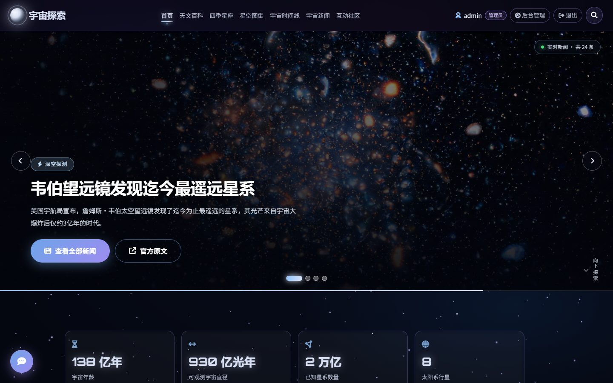
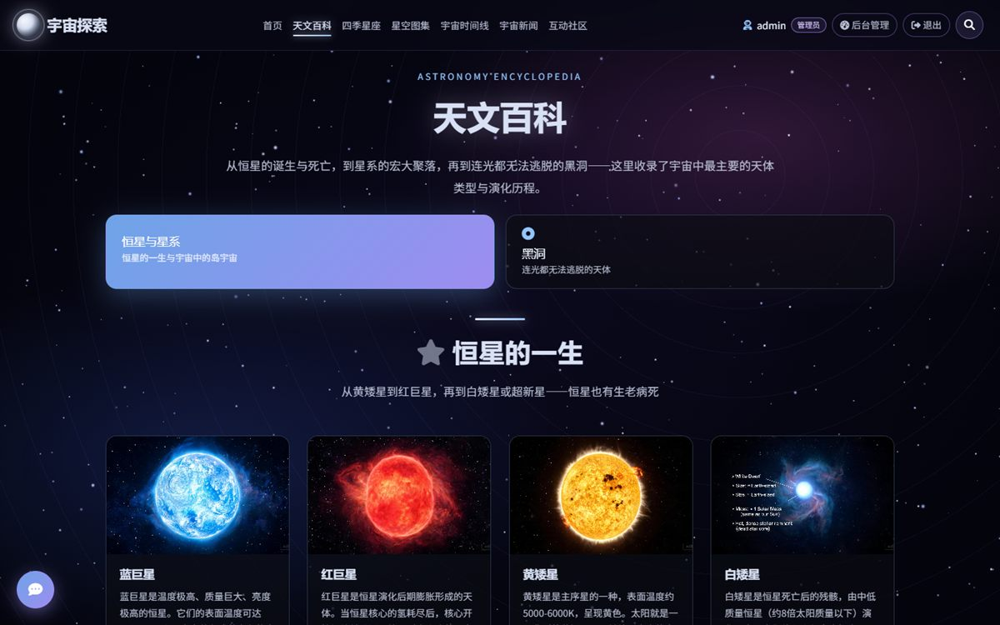
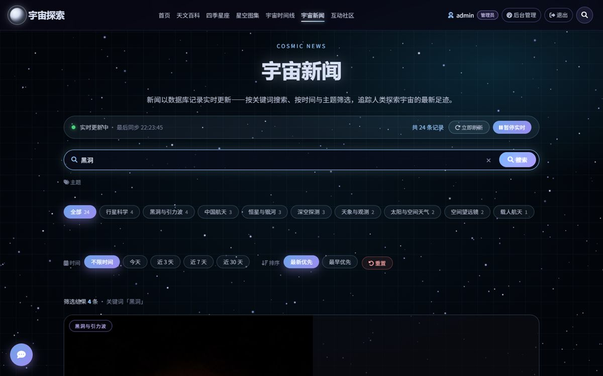
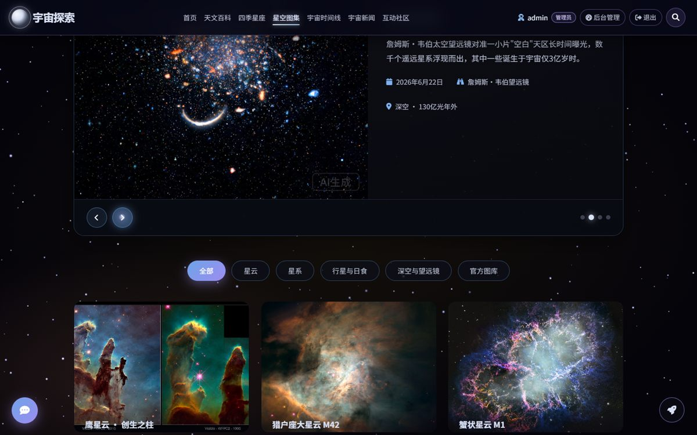
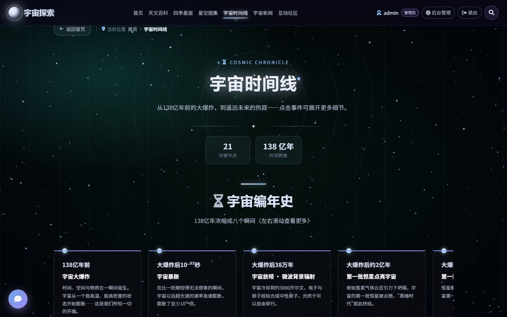
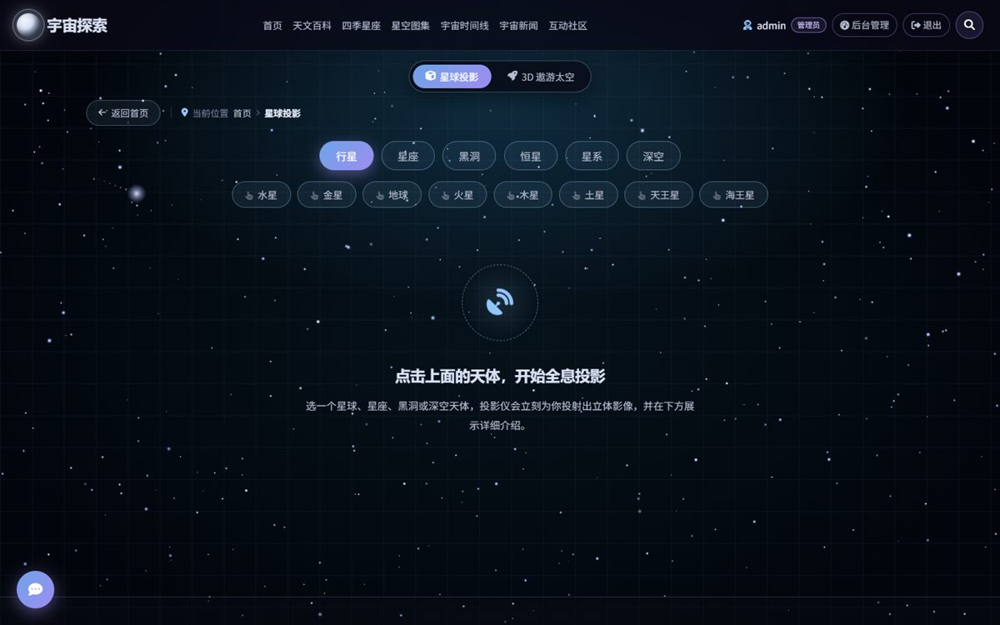
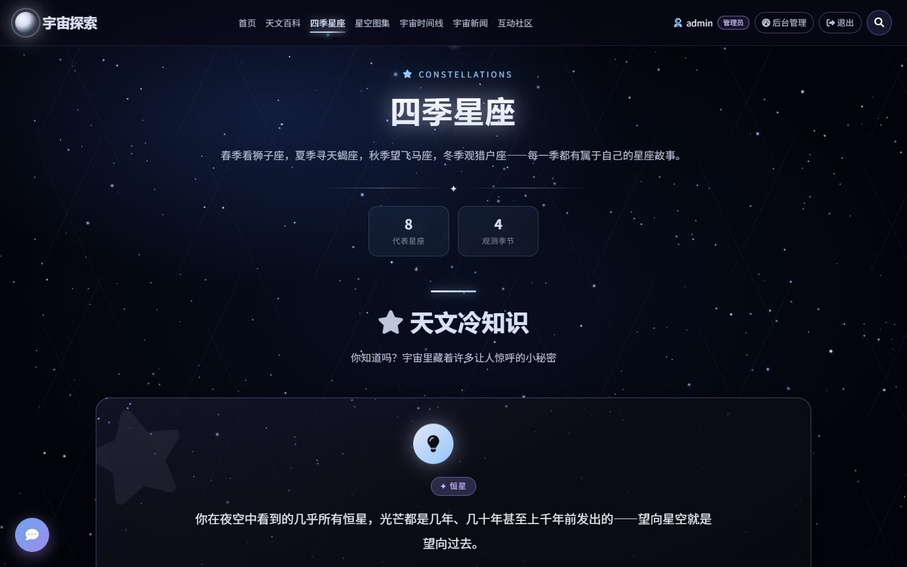

# 宇宙探索 · 天文科普网站系统

> 一个基于 **Vue 3 + Node.js (Express) + MySQL 8 + Three.js** 的全栈天文科普平台，
> 包含八大主题科普内容、3D 星球投影与遨游太空、数据库驱动的实时新闻、知识竞赛与社区互动。

<p align="center">
  
</p>

---

## 目录

- [一、项目介绍](#一项目介绍)
- [二、功能特性](#二功能特性)
- [三、技术架构](#三技术架构)
- [四、目录结构](#四目录结构)
- [五、环境配置](#五环境配置)
- [六、安装与运行](#六安装与运行)
- [七、代码规范](#七代码规范)
- [八、接口一览](#八接口一览)
- [九、测试](#九测试)
- [十、Git 提交记录](#十git-提交记录)
- [十一、团队信息](#十一团队信息)
- [十二、常见问题](#十二常见问题)
- [十三、原创性与参考说明](#十三原创性与参考说明)
- [十四、许可证与素材声明](#十四许可证与素材声明)

---

## 一、项目介绍

**宇宙探索** 是一个面向大众的天文科普网站，把晦涩的天文知识做成可读、可点、可玩的交互体验。

内容体系覆盖 **太阳系 → 恒星与星系 → 黑洞 → 四季星座 → 深空天体 → 宇宙时间线**，
并内置 **「星穹」AI 天文助手**：站内知识库 RAG（词法 + 本地向量混合检索）、回答带角标溯源、三级降级（大模型 → 本地检索 → 兜底引导）、三个「哇」时刻（月相计算 / 今夜观星 / 一句话带你去木星）；
全站完成 **移动端适配**（390 / 360 / 768 三档视口零横向溢出，导航收进汉堡菜单）；
四季星座页升级为 **「当季天象台」**：实时月相与观星指南（纯 JS 计算）、当季流星雨与深空目标日历、三垣四象二十八宿（中西星官对照）、认星口诀；
并提供 **3D 星球投影**、**3D 遨游太空**（真实公转周期）等沉浸式体验；
同时具备完整的用户体系（注册登录、知识竞赛、排行榜、留言板）与管理员后台。

> 本项目为 **传智杯（全国大学生 IT 技能大赛）** 参赛作品，包含完整的前后端实现、容器化部署方案与自动化测试。

| 首页 | 天文百科 |
|---|---|
|  |  |

| 互动社区（竞赛 + 排行榜） | 宇宙新闻（搜索 + 筛选） |
|---|---|
|  |  |

| 星空图集（APOD + 图库） | 宇宙时间线 |
|---|---|
|  |  |

| 星球投影 / 3D 遨游太空 | 四季星座 |
|---|---|
|  |  |

---

## 二、功能特性

### 科普内容

- **天文百科**：恒星的一生、星系类型、四类黑洞与黑洞数据（合并原「恒星与星系」「黑洞科普」）
- **太阳系行星**：八大行星的直径、距离、公转周期与真实影像
- **四季星座**：8 个代表星座的亮星、观测季节与神话传说；按当前月份自动选中当季，真实恒星坐标连线 + 四季配色
- **星空图集**：41+ 张哈勃 / 韦伯等官方影像，支持分类筛选、灯箱放大、图片来源标注
- **宇宙时间线**：从大爆炸到热寂的 21 个关键节点，支持按时代筛选与展开详情
- **近地天体观察站**：对接 NASA NeoWs，实时倒计时 + 尺寸/速度/最近距离，离线时自动回退内置数据
- **宇宙新闻**：数据库驱动的实时新闻流，支持关键词搜索（含搜索记录）、主题 / 时间 / 排序筛选

### 3D 互动

- **星球投影**：38 个天体，点击生成 3D 全息投影 + 详细图文
- **3D 遨游增强**：小行星带（InstancedMesh 1600 颗）、行星标签、点击天体相机飞掠 + 信息面板
- **遨游太空**：真实公转周期（水星 88 天 → 海王星 165 年）、时间流速与距离比例滑块
- **首页入口**：可点击地球穿越进投影页、迷你太阳系点击行星直达详情

### 用户与社区

- 注册 / 登录（算术验证码、bcrypt 加密、httpOnly Cookie）
- 知识竞赛：24 题题库、按主题抽题、即时解析、错题回顾
- 星际排行榜：正确率 → 答对题数 → 用时排序，**15 秒实时刷新**
- 留言板：浏览公开，登录后发布
- 管理员后台：概览统计、7 日访问趋势、热门页面、用户 / 成绩 / 留言 / 新闻管理

### 工程特性

- 全站响应式、每页独立背景氛围、返回首页记忆滚动位置、统一「返回首页」导航条
- 安全：helmet + CSP、API 限流、环境变量隔离密钥、参数化 SQL 防注入
- 性能：brotli/gzip 预压缩、哈希资源一年强缓存、视频按需加载
- 部署：Docker 多阶段构建 + 完全离线分发包
- 质量：ESLint 零告警、120+ 项自动化回归测试

---

## 三、技术架构

### 系统架构图

```
┌─────────────────────────────────────────────────────────────┐
│                         浏览器（客户端）                       │
│   Vue 3 SPA · Vue Router · Pinia · Axios · Three.js          │
└───────────────────────────┬─────────────────────────────────┘
                            │ HTTP / Cookie 认证
┌───────────────────────────▼─────────────────────────────────┐
│                    Node.js (Express) 服务端                   │
│  ├─ 安全层：helmet / CSP / CORS / 限流 / Cookie 解析           │
│  ├─ 路由层：auth · scores · messages · news · admin · chat    │
│  ├─ 中间件：JWT 认证（每次请求实时查库鉴权）                     │
│  ├─ 静态托管：brotli/gzip 预压缩 + 强缓存 + SPA 回退            │
│  └─ 日志：单行 JSON（结构化）                                  │
└───────────────────────────┬─────────────────────────────────┘
                            │ mysql2 连接池（时区 +08:00）
┌───────────────────────────▼─────────────────────────────────┐
│                        MySQL 8.0                             │
│   users · scores · messages · visits · news                  │
└─────────────────────────────────────────────────────────────┘
```

### 技术栈

| 层次 | 技术选型 | 版本 | 说明 |
|---|---|---|---|
| 前端框架 | Vue 3（`<script setup>`） | 3.5 | 组合式 API |
| 构建工具 | Vite | 5.4 | 路由级懒加载 + 代码分割 |
| 路由 / 状态 | Vue Router / Pinia | 4.5 / 2.3 | history 模式、认证守卫 |
| HTTP | Axios | 1.7 | `withCredentials` 携带 Cookie |
| 3D 渲染 | Three.js | 0.186 | 星球投影、3D 遨游太空 |
| 后端 | Node.js + Express | 24 / 4.19 | CommonJS |
| 数据库 | MySQL + mysql2 | 8.0 / 3.11 | 连接池、参数化查询 |
| 认证 | jsonwebtoken + bcryptjs | 9.0 / 2.4 | httpOnly Cookie、异步哈希 |
| 安全 | helmet + express-rate-limit | 8.0 / 7.4 | CSP、限流 |
| 部署 | Docker + Docker Compose | 29 / v5 | 多阶段构建、健康检查 |

### 关键设计

| 主题 | 设计 |
|---|---|
| **认证** | JWT 存 httpOnly + SameSite Cookie，前端 JS 不可读；退出时服务端 `token_version + 1` 使旧 token 立即失效 |
| **权限** | 每次请求从数据库读取最新角色，管理员改权限无需重新登录 |
| **时区** | 容器 `TZ=Asia/Shanghai`、MySQL `+08:00`、连接池 `timezone: '+08:00'`，API 统一返回 ISO 8601 |
| **排名口径** | 名次与排行榜使用同一 SQL 排序（正确率 → 答对题数 → 用时 → 提交时间），且都按分类统计 |
| **压缩缓存** | 构建期预生成 `.br` / `.gz`，`assets/*` 一年 immutable，入口 HTML no-cache |
| **可观测** | `/api/health`（含数据库探测）+ 容器 HEALTHCHECK + 结构化 JSON 日志 |

---

## 四、目录结构

```
天文科普/
├── client/                     # 前端（Vue 3）
│   ├── public/assets/          # 图片 / 球面贴图 / 科普视频 / 图标字体
│   ├── src/
│   │   ├── api/                # Axios 实例（Cookie 认证）
│   │   ├── components/         # 通用组件（导航、背景、AI 对话、视频区块…）
│   │   ├── data/               # 内容数据（46 详情页 / 38 投影 / 24 题库 / 9 视频）
│   │   ├── router/             # 路由与守卫（含首页滚动位置记忆）
│   │   ├── store/              # Pinia（auth / ui）
│   │   ├── utils/              # 时间格式化等工具
│   │   ├── views/              # 20 个页面视图
│   │   └── style.css           # 设计系统与全局样式
│   └── vite.config.js
├── server/                     # 后端（Express）
│   ├── app.js                  # 应用装配（安全中间件 / 路由 / 静态托管）
│   ├── index.js                # 启动入口
│   ├── config.js               # 配置（全部来自环境变量）
│   ├── db.js                   # 连接池 + 建表 + 种子数据
│   ├── logger.js               # 结构化日志
│   ├── asyncRoute.js           # async 路由异常包装
│   ├── chat.js                 # 天文知识库 + 可选 LLM
│   ├── middleware/             # auth（Cookie 认证）/ security（helmet + 限流）
│   └── routes/                 # auth / scores / messages / news / admin / chat / misc
├── tools/                      # 构建与测试脚本
│   ├── verify-all.js           # API 回归
│   ├── verify-frontend.js      # 前端回归
│   ├── gen-sitemap.js          # 生成 sitemap
│   ├── precompress.js          # brotli/gzip 预压缩
│   └── gen-git-history.js      # 生成提交历史页面
├── docs/screenshots/           # README 截图
├── Dockerfile                  # 多阶段构建
├── docker-compose.yml          # 生产编排
├── docker-compose.offline.yml  # 离线编排
├── .env.example                # 环境变量模板
├── eslint.config.mjs           # ESLint 9 扁平配置
├── .editorconfig / .prettierrc.json / .gitattributes
├── start.bat                   # Windows 一键启动
└── README.md
```

---

## 五、环境配置

### 5.1 环境要求

| 依赖 | 版本要求 | 说明 |
|---|---|---|
| Node.js | **>= 20**（推荐 24） | 见 `.nvmrc` / `package.json` 的 `engines` |
| npm | >= 9 | 随 Node 安装 |
| MySQL | **8.0+** | 需支持 utf8mb4；Docker 部署可免安装 |
| 操作系统 | Windows / macOS / Linux | 已在 Windows 11 + Docker Desktop 验证 |
| 浏览器 | Chrome / Edge 最新版 | 需支持 WebGL2（3D 页面） |

### 5.2 环境变量模板

复制 `.env.example` 为 `.env` 并修改：

```bash
cp .env.example .env
```

| 变量 | 必填 | 默认值 | 说明 |
|---|---|---|---|
| `NODE_ENV` | 否 | `production` | 运行环境 |
| `PORT` | 否 | `3000` | 服务端口 |
| `TZ` | 否 | `Asia/Shanghai` | 站点时区 |
| `TZ_OFFSET` | 否 | `+08:00` | MySQL 会话时区偏移 |
| `DB_HOST` | 否 | `127.0.0.1` | 数据库地址（Docker 中为 `db`） |
| `DB_PORT` | 否 | `3306` | 数据库端口 |
| `DB_NAME` | 否 | `astro` | 数据库名 |
| `DB_USER` | 否 | `astro` | 数据库用户 |
| `DB_PASSWORD` | **是** | — | 数据库密码 |
| `JWT_SECRET` | **是** | 随机生成 | 令牌签名密钥（建议 32 位随机） |
| `JWT_EXPIRES` | 否 | `7d` | 登录有效期 |
| `COOKIE_SECURE` | 否 | `0` | HTTPS 反代时设为 `1` |
| `CORS_ORIGINS` | 否 | 空（同源） | 跨域白名单，逗号分隔 |
| `ADMIN_USER` / `ADMIN_PASSWORD` | 建议 | `admin` / 空 | 初始管理员（密码留空则启动时随机生成并打印） |
| `RATE_LIMIT_MAX` | 否 | `240` | 每分钟 API 请求上限 |
| `RATE_LIMIT_AUTH_MAX` | 否 | `20` | 登录/注册限流（5 分钟） |
| `AI_API_KEY` | 否 | 空 | 填入后启用真实大模型问答 |
| `AI_BASE_URL` / `AI_MODEL` | 否 | DeepSeek | OpenAI 兼容接口地址与模型 |
| `HOST_PORT` | 否 | `3000` | Docker 映射到宿主机的端口 |
| `MYSQL_ROOT_PASSWORD` | Docker | — | MySQL root 密码（仅容器内部） |
| `SITE_URL` | 否 | `http://localhost:3000` | 生成 sitemap 时的站点地址 |

生成 JWT 密钥：

```bash
node -e "console.log(require('crypto').randomBytes(32).toString('hex'))"
```

> 所有密钥均从环境变量读取，**代码与 compose 文件中不含任何明文口令**。

### 5.3 依赖清单

**前端 `client/package.json`**

| 依赖 | 版本 | 用途 |
|---|---|---|
| vue | ^3.5.13 | 前端框架 |
| vue-router | ^4.5.0 | 路由 |
| pinia | ^2.3.0 | 状态管理 |
| axios | ^1.7.9 | HTTP 客户端 |
| three | ^0.186.1 | 3D 渲染 |
| vite（dev） | ^5.4.11 | 构建工具 |
| @vitejs/plugin-vue（dev） | ^5.2.1 | Vue 插件 |

**后端 `server/package.json`**

| 依赖 | 版本 | 用途 |
|---|---|---|
| express | ^4.19.2 | Web 框架 |
| mysql2 | ^3.11.0 | MySQL 驱动（连接池） |
| jsonwebtoken | ^9.0.2 | JWT 签发与校验 |
| bcryptjs | ^2.4.3 | 密码哈希 |
| helmet | ^8.0.0 | 安全响应头 |
| express-rate-limit | ^7.4.1 | 接口限流 |
| compression | ^1.7.5 | gzip 压缩 |
| cookie-parser | ^1.4.7 | Cookie 解析 |
| cors | ^2.8.5 | 跨域（可选） |

**根目录开发依赖**

| 依赖 | 版本 | 用途 |
|---|---|---|
| eslint | ^9 | 代码检查 |
| eslint-plugin-vue | ^9 | Vue 规则 |
| @eslint/js / globals | ^9 / ^15 | 基础规则与环境变量 |

一键安装全部依赖：

```bash
npm run install:all
```

---

## 六、安装与运行

### 方式 A：Docker（推荐，免装 MySQL）

```bash
cp .env.example .env      # 修改 DB_PASSWORD / JWT_SECRET / ADMIN_PASSWORD
docker compose up -d --build
```

浏览器访问 <http://localhost:3000>，管理员 `admin / admin123`（首次登录后请修改）。

> 完整离线部署（含 MySQL 镜像、源码、一键脚本）见 [README-Docker.md](README-Docker.md)。

### 方式 B：本机运行

```bash
# 1. 准备数据库（MySQL 8）：创建库 astro 与用户 astro，字符集 utf8mb4
# 2. 配置环境变量
cp .env.example .env      # 填入 DB_PASSWORD / JWT_SECRET 等
# 3. 安装依赖
npm run install:all
# 4. 构建前端
npm run build
# 5. 启动服务
npm start                 # 或双击 start.bat（Windows 会顺带启动 MySQL）
```

后端首次启动会**自动建表**并写入 24 条新闻与默认管理员。

### 方式 C：开发模式（热更新）

```bash
npm run dev:server        # 终端 1：http://127.0.0.1:3000
npm run dev:client        # 终端 2：http://127.0.0.1:5173（已代理 /api）
```

---

## 浏览器走查与修复（2026-10）

用 Puppeteer 对 **19 个页面 × 桌面（1440×900）/ 移动（390×844）** 逐页走查，自动检测：JS 错误、横向溢出、
破图、元素越界、页头/导航缺失、顶部导航遮挡、移动端点击目标尺寸，并验证聊天挂件流式输出。

### 本轮发现并修复

| 问题 | 影响 | 修复 |
|---|---|---|
| 页面顶部「返回首页 / 当前位置」被固定导航遮住 | 所有使用 `PageNav` / 面包屑的页面（桌面遮 9px、移动遮 25px） | `.container` 顶部内边距改为 `calc(var(--nav-h) + 1.3rem)`，移动端同步加大 |
| 首页太阳系图例在手机上溢出被裁切 | 移动端部分行星按钮点不到 | ≤900px 时允许换行并限制宽度 |

### 同时修复

- **`embeddingsReady()` 恒真**：原实现 `return !!config.embed.enabled || true` 永远为真；改为返回真实配置状态，并在 `verify-rag` 中断言「与实际配置一致」
- **全局聊天挂件未接流式**：抽出 `client/src/utils/streamChat.js`（SSE 解析 + 非流式降级），挂件改为逐字输出 + 闪烁光标 + 来源/级别徽标，支持本地 Key/模型偏好

```bash
node tools/verify-visual.js --shots   # 走查并输出截图到 shots/walk/
```

## 邮箱绑定与找回密码（2026-10）

### 注册绑定邮箱

注册时**必须填写邮箱**（格式校验 + 全站唯一），用于账号找回；注册成功即完成绑定。

### 忘记密码（页面弹窗验证码）

登录页点击「忘记密码？」→ 在弹窗内输入注册邮箱 → 校验通过后**弹窗直接显示 6 位验证码** → 输入验证码并设置新密码：

| 环节 | 实现 |
|---|---|
| 邮箱校验 | 未注册邮箱弹窗提示「**没有该用户**」；已注册才生成验证码 |
| 验证码 | 6 位随机数字（HMAC 哈希入库），当前弹窗内展示，**10 分钟有效**、一次性使用 |
| 新密码校验 | 至少 8 位；**不能与原密码相同**（bcrypt 比对旧哈希） |
| 重置 | bcrypt 重新加密，同时 `token_version + 1` 使旧登录态全部失效 |
| 提示方式 | 所有校验与结果（没有该用户 / 验证码错误 / 与原密码相同 / 修改成功）均为**弹窗提示** |
| 频控 | 同一邮箱 60 秒内不可重复生成验证码；验证码最多尝试 5 次 |

> 不需要配置邮箱服务器即可使用：验证码直接显示在页面弹窗中。如配置了 `SMTP_*`，会同时把验证码真实发送到邮箱（可选增强）。

> 数据库迁移自动完成：启动时给 `users` 表补 `email` 列与唯一索引，并创建 `password_resets` 表（旧库无需手动改表）。
> 自动化验证：`node tools/verify-auth-email.js`（23 项，含页面流程）。

## 内容事实校订（2026-10）

答辩前对会被 RAG 复述的高风险表述做了校对，修正三处（含 3D 投影页的同源文案）：

| 位置 | 原表述 | 修正后 |
|---|---|---|
| 哈勃深空场 | 面积「满月的 1/2400」 | 约**满月面积的 1/130**（约全天两千四百万分之一） |
| 创生之柱 | 「最新观测表明已被摧毁」 | 「**有研究推测**……（2007 年假说，仍有争议，尚未成为定论）」 |
| 参宿四 | 直径「约 1000 倍太阳」 | 约 **800–1000 倍**太阳直径；表面延伸到约 **3–4 AU**（接近木星轨道，但仍在轨道以内） |

同时通读了 `quiz.js` 全部 **24 道题**：答案索引、选项、解析均合法；措辞优化 3 处（太阳星云、土星环厚度、黑洞前身质量表述）。

> RAG 索引由内容自动构建，修改后重新构建镜像即可生效；`tools/verify-content-facts.js` 会同时校验源数据与真实 RAG 回答，防止错误表述回归。

## 信息架构与视觉一致性（2026-10）

### 导航（平铺 8 项）

导航保持平铺：**首页 / 天文百科 / 四季星座 / 星空图集 / 宇宙时间线 / 近地天体 / 宇宙新闻 / 互动社区**，
窄屏（≤1024px）自动收进汉堡菜单；AI 助手与搜索作为独立入口在右侧。

### 老页面主题统一

视频页、详情页、404 页此前仍使用各写一套的旧类（`.sys-card` / `.detail-header` / `.nf-*`），现已全部迁移到统一设计系统：

| 页面 | 改造 |
|---|---|
| 科普视频 | 保留 PageHeader；版权说明改用共享 `.info-card`；返回键改用共享 `.page-back` |
| 天体详情 | 自定义 `.detail-header` → 统一 `<PageHeader>`，关键数据在页头以统计卡展示；面包屑保留 |
| 404 | 自定义星空布局 → `<PageHeader>` + 统一信息卡（404 大字 + 返回按钮） |

> 共享类定义在 `client/src/style.css`（`.page-back` / `.info-card`），新页面直接复用，避免再出现「每页一套」。

## 六·五、AI 天文助手（RAG 实现说明）

| 环节 | 实现 |
|---|---|
| **建库** | 扫描站内数据（行星 / 星座 / 百科长文 / 时间线）+ 常见概念 FAQ，切分为 **141 个知识块**，覆盖 **52 个来源页面** |
| **检索** | 词法（中文 bigram 重合度 + 专名加权）× 本地向量（FNV-1a 哈希投影 + TF-IDF + 余弦相似度），按 0.62 / 0.38 融合；配置 `AI_EMBED_*` 时自动切换为语义向量；结果按正文前缀去重 |
| **生成** | 配置 `AI_API_KEY` 时调用 OpenAI 兼容接口，提示词要求带【1】【2】角标引用资料；前端把角标渲染成上标徽标，与来源列表一一对应 |
| **三级降级** | ① 大模型生成 → ② 本地知识库原文摘录（同样可溯源）→ ③ 兜底引导 + 可点推荐问题。断网、无 Key、超时都会自动降级，比赛现场不会白屏 |
| **装备导购 / 参数助手** | 输入预算 + 用途（看月亮 / 行星星空 / 目视深空 / 深空摄影 / 星野 / 便携），规则引擎给出 1–3 套配置：主镜 + 赤道仪 + 相机 + 附件、总价、光学参数（口径 / 焦比 / 极限星等 / 道斯极限 / 倍率范围）、推荐理由与升级路径；预算不足时说明门槛并给起步方案 |
### 角色设定（星穹）

站内 AI 的角色名为「**星穹**」，系统提示词由「人设 + 上下文 + 语气 + 边界」四部分组成（`server/chat.js` 的 `PERSONA_BASE`）：

| 维度 | 规则 |
|---|---|
| **人设** | 星穹，搭载在「宇宙探索」天文科普网站上的 AI 天文科普助手；精通天文学、宇宙学、航天科技，擅长把复杂知识讲得通俗有趣 |
| **上下文** | 结合多轮历史推断代词与省略主语（例：「木星有多大」→「那它有几颗卫星」中的「它」= 木星）；无法推断时请用户澄清，不编造 |
| **语气** | 专业、耐心、充满探索欲；结构清晰，善用列表与 **粗体**；结尾用一句话引导继续提问 |
| **边界** | 只答天文/宇宙/航天/科学问题；无关问题用俏皮话引回宇宙（「虽然我不会做红烧肉，但如果你有一块火星土壤……」）；前沿争议明确「目前科学界尚无定论」 |

同一套人格下仍保留 **儿童 / 业余爱好者 / 专业人士** 三档表达差异（字数与术语深度不同）。

### AI 连接设置（站点内置 Key / 我的 Key）

AI 页状态条下方提供「AI 连接设置」，两种方式随时切换（参考问卷系统的交互）：

| 方式 | 说明 |
|---|---|
| **站点内置 Key**（默认） | 读取服务器环境变量 `AI_API_KEY`，访客无需配置即可使用；页面显示掩码 |
| **我的 DeepSeek Key** | 在弹窗粘贴自己的 Key，前端调用 `POST /api/chat/verify-key` 实时校验（DeepSeek 余额接口，返回余额与耗时），通过后仅保存在**本机浏览器 localStorage** |

实现要点：

- 请求级 Key：前端在 `/api/chat`、`/api/chat/stream` 请求头带 `X-AI-Key`，服务端 `normalizeKey()` 校验格式后优先使用，失败/为空则回退站点内置 Key
- 安全：Key 不写数据库、不写日志；格式只接受 `sk-` 开头；掩码展示（`sk-xxxx****xxxx`）
- 切回：弹窗内「清除我的 Key，改用站点内置 Key」一键还原
- 移动端：弹窗自适应（输入行堆叠、按钮满宽）

### 模型切换（极速问答 / 深度推理）

AI 页连接栏提供模型切换，按问题复杂度选择：

| 模型 | 名称 | 适合 |
|---|---|---|
| `deepseek-chat` | 极速问答 | 日常科普问答，响应快（默认） |
| `deepseek-reasoner` | 深度推理 | 复杂机制/争议问题，先推理再作答，耗时更长 |

实现要点：

- 白名单：`AI_MODELS` 环境变量配置（默认两项），服务端 `normalizeModel()` 校验，非法值自动回退默认模型
- 推理适配：reasoner 对 system 消息支持有限，服务端自动把 system + 上下文合并成单条 user；不传 temperature；超时放大到 120s
- 思考过程：流式解析 `delta.reasoning_content`，以 `reasoning` 事件推给前端，回答气泡内以可折叠「思考过程」展示
- 前端记忆：选择保存在 `localStorage('astro_ai_model')`，回答元信息会标注实际使用的模型与「深度推理生成」级别

| **流式输出（SSE）** | `POST /api/chat/stream` 以 SSE 逐 token 推送大模型回答；前端打字机逐字显示（约 60 字/秒）并带闪烁光标，来源/级别/工具徽标在首字前就绪；本地检索与工具回答整段下发后同样逐字显示；不支持流式时自动回退普通接口 |
| **能力卡快捷入口** | 月相计算 / 今夜观星 / 页面导航 / 装备导购四张卡均可点击：前两张直接发起对应提问并展示工具结果，页面导航展开 8 个站内快捷入口 |
| **多受众模式** | 儿童 / 业余爱好者 / 专业人士三档：大模型提示词、本地降级文案、装备讲解方式都随档位切换（儿童用比喻与短句 + 安全提示，业余给结论与参数，专业给规格、载重与采样权衡），页面选择会记住 |
| **工具调用（零 API 依赖）** | 月相计算（朔望月推算）、今夜观星（月相 + 日落暮光 + 当季星座实时方位高度）、页面导航（「带我去木星」自动跳转详情页） |
| **相关性门槛** | 最高检索分 < 0.26 视为无命中，走第 3 级兜底，避免用不相关资料硬答 |

### 赛题方向对应（方向②：向量数据库 + 检索增强生成）

| 赛题要求 | 本项目实现 | 代码位置 |
|---|---|---|
| 向量数据库 | 1024 维哈希向量库，gzip 持久化（`server/rag/.local-index.json`），内容 hash 变化自动增量重建；镜像构建期预生成 | `server/rag/localVector.js`、`server/rag/build-index.js` |
| 结构化知识库 | 站内数据自动切片：行星 / 星座 / 百科长文 / 时间线 + 概念 FAQ = **141 知识块 / 52 来源页** | `server/rag/data.js`、`server/rag/faq.js` |
| 混合检索 | 词法（中文 bigram + 专名加权 0.62）× 向量（TF-IDF 余弦 0.38）融合；结果正文前缀去重 | `server/rag/search.js` |
| 检索增强生成 | 配置 `AI_API_KEY` 时把 Top-K 片段注入提示词，要求【1】【2】角标引用 | `server/chat.js` |
| 可溯源 | 角标 → 来源卡片（标题 + 站内路由），前端可点击跳转 | `client/src/views/AiAssistantView.vue` |
| 可靠性 | 三级降级：大模型 → 本地知识库原文摘录 → 兜底引导 + 推荐问题 | `server/chat.js` |
| 检索评估 | `tools/verify-rag.js`：10 条标注查询计算 Hit@1 / Hit@3 / MRR，并校验索引持久化 | `tools/verify-rag.js` |
| 领域扩展：装备导购 | 预算 + 用途 → 主镜/赤道仪/相机/附件组合，含光学参数计算与预算约束（规则引擎，离线可用） | `server/rag/gear.js`、`server/rag/gearAdvisor.js` |
| 领域扩展：多受众表达 | 同一知识用儿童 / 业余 / 专业三种讲法输出（提示词 + 本地降级文案双通道） | `server/chat.js`、`client/src/views/AiAssistantView.vue` |

> 检索评估（ode tools/verify-rag.js，10 条标注查询）：**Hit@1 90% · Hit@3 100% · MRR 0.950**。
>
> 向量库状态可通过 `GET /api/chat/mode` 查看（维度、知识块数、索引来源 disk/built、文件大小）。

> 检索质量示例（离线模式）：`光年是什么单位` → 命中 FAQ（1.09 分）；`如何做红烧肉` → 无命中，触发兜底。

---

## 七、代码规范

### 7.1 工具链

| 工具 | 配置文件 | 作用 |
|---|---|---|
| **ESLint 9** | `eslint.config.mjs`（扁平配置：前端 Vue + 后端 Node 两套规则） | 静态检查 |
| **EditorConfig** | `.editorconfig` | 统一缩进 / 换行 / 编码 |
| **Prettier** | `.prettierrc.json` | 统一代码格式 |
| **Git attributes** | `.gitattributes` | 换行符与二进制文件处理 |

```bash
npm run lint       # 检查（当前 0 error / 0 warning）
npm run lint:fix   # 自动修复
```

### 7.2 编码约定

- 缩进 4 空格、单引号、语句结尾分号、行宽 120
- 前端统一 `<script setup>` 组合式 API；组件名 PascalCase，文件名与组件名一致
- 后端按「路由 / 中间件 / 数据层」分层，`async` 路由统一用 `asyncRoute` 包装，异常收敛到统一错误处理
- 所有配置经 `config.js` 读取环境变量，不在代码内硬编码密钥
- 数据库访问一律使用参数化查询，禁止拼接 SQL
- 关键逻辑写中文注释说明「为什么」而非「是什么」

### 7.3 目录与命名约定

| 类型 | 约定 | 示例 |
|---|---|---|
| 页面视图 | `XxxView.vue` | `EncyclopediaView.vue` |
| 通用组件 | 名词 PascalCase | `PageNav.vue`、`StarField.vue` |
| 后端路由 | 资源名小写复数 | `routes/scores.js` |
| 工具脚本 | 动词-名词 | `gen-sitemap.js`、`verify-all.js` |

### 7.4 提交信息规范（Conventional Commits）

```
<type>(<scope>): <subject>

feat: 新功能      fix: 修复        docs: 文档
style: 格式      refactor: 重构    test: 测试
chore: 构建/工具  perf: 性能优化
```

示例：`feat(gallery): 今日天文图片移至星空图集页顶部`

---

## 八、接口一览

| 方法 | 路径 | 权限 | 说明 |
|---|---|---|---|
| GET | `/api/health` | 公开 | 健康检查（含数据库状态） |
| GET | `/api/captcha` | 公开 | 算术验证码 |
| POST | `/api/register` | 公开 | 注册（需验证码） |
| POST | `/api/login` | 公开 | 登录（下发 httpOnly Cookie） |
| POST | `/api/logout` | 公开 | 退出（服务端失效 token） |
| GET | `/api/me` | 登录 | 当前用户 |
| POST | `/api/scores` | 登录 | 上传成绩（返回同口径名次） |
| GET | `/api/my-scores` | 登录 | 我的成绩 |
| GET | `/api/leaderboard?cat=` | 公开 | 排行榜 |
| GET | `/api/messages` | 公开 | 留言列表 |
| POST | `/api/messages` | 登录 | 发布留言 |
| GET | `/api/news?tag=&q=&days=&sort=` | 公开 | 新闻（支持搜索 / 筛选） |
| GET | `/api/neo` | 公开 | 近地天体（NASA NeoWs 实时，失败回退内置数据，6 小时缓存） |
| GET | `/api/chat/mode` · POST `/api/chat` | 公开 | 问答模式 / 提问 |
| POST | `/api/visit` | 公开 | 访问统计 |
| GET | `/api/admin/overview` · `/admin/users` 等 | 管理员 | 后台数据 |
| POST/PUT/DELETE | `/api/admin/news/:id` | 管理员 | 新闻管理 |
| DELETE | `/api/admin/users/:id` | 管理员 | 删除用户（连带其成绩与留言，不能删除管理员） |

---

## 九、测试

| 脚本 | 覆盖范围 | 用例数 |
|---|---|---|
| `npm run test:api` | 健康检查、公开接口、安全头、缓存压缩、验证码注册、Cookie 认证、权限、时区、排名口径、异常处理、限流、SEO | 45 |
| `npm run test:ui` | 游客访问、受控页面、登录流程、Cookie 属性、页面功能 | 34 |
| `tools/verify-timeline.js` | 宇宙编年史位置与文本渲染 | 8 |
| `tools/verify-pagenav.js` | 返回首页导航条（6 个有入口 + 5 个无入口） | 26 |
| `tools/verify-apod.js` | 今日天文图片位置与轮播 | 8 |
| `tools/verify-facts.js` | 四季星座页区块 | 13 |
| `tools/verify-scrollback.js` | 返回首页滚动位置恢复 | 7 |
| `tools/verify-books.js` | 各页面主题书单（13 个页面 + 首页无） | 54 |
| `tools/verify-header.js` | 增强版页头（标题/kicker/数据卡，11 个页面） | 71 |
| `tools/verify-wins.js` | 聚光灯边框、骨架屏、段位徽章、星座连线 | 21 |
| `tools/verify-icons.js` | Font Awesome 图标可用性审计 | 115 |
| `tools/verify-a11y.js` | 键盘焦点、减少动态、导航激活态、页脚彩蛋 | 15 |
| `tools/verify-home.js` | 首页轮播进度条、指示点、数据条、向下探索 | 15 |
| `tools/verify-pages.js` | 百科分类卡、时间线标尺与色带、书封、页头装饰 | 17 |
| `tools/verify-404-auth.js` | 404 星际漂流页、登录注册星云与玻璃卡片 | 13 |
| `tools/verify-3d-neo.js` | 小行星带、行星标签、点击飞掠面板、NEO 页与接口 | 25 |
| `tools/verify-3d-render.js` | 3D 画布实际渲染（默认与 ?nolog=1 兜底模式） | 5 |
| `tools/verify-3d-recover.js` | 飞掠后遮罩复位、复位按钮与 R 键恢复视角 | 12 |
| `tools/verify-pages2.js` | 详情页/视频页/下载页/深空页本轮改进（37 项） | 37 |
| `tools/verify-sky.js` | 当季天象台：月相/观星指南/天象日历/四象二十八宿/认星口诀 | 37 |
| `tools/verify-chat.js` | AI 问答：三级降级、工具调用、混合检索、溯源与多轮会话（自适应 LLM/离线模式） | 36 |
| `tools/verify-ai-ui.js` | AI 助手界面：角标溯源、级别/工具徽标、兜底推荐、自动跳转（自适应 LLM/离线） | 18 |
| `tools/verify-mobile.js` | 移动端（iPhone 12 / 360px / iPad）：横向溢出、汉堡菜单、关键页可用性 | 90 |
| `tools/verify-mobile-app.js` | 移动端 H5 专版：底部 Tab 导航、AI/3D 适配、PWA 安装与注册 | 32 |
| `tools/verify-ux-fixes.js` | 视频返回键与主题唯一匹配、书籍精简、AI 能力卡交互 | 23 |
| `tools/verify-stream.js` | 流式输出：逐字递增、打字光标、结束状态、桌面/移动端 | 18 |
| `tools/verify-persona.js` | 角色设定：代词指代、无关问题引导、不确定声明、语气结构、儿童简短 | 9 |
| `tools/verify-ai-key.js` | AI 连接设置：Key 校验、状态切换、本地持久化、清除、移动端 | 26 |
| `tools/verify-model.js` | 模型切换：白名单/回退、推理模型、流式 reasoning、界面持久化 | 23 |
| `tools/verify-content-facts.js` | 内容事实校订：深空场面积、创生之柱假说、参宿四尺寸、quiz 题库合法性 | 20 |
| `tools/verify-visual.js` | 浏览器走查：19 页 × 桌面/移动 + 挂件流式（错误/溢出/破图/越界/遮挡） | 230 |
| `tools/verify-images.js` | 图片资源完整性：无缺失、无水印文字、尺寸合理 | 8 |
| `tools/verify-rag.js` | RAG 检索评估：Hit@1/Hit@3/MRR + 向量库状态 + embeddingsReady 一致性 + 端到端问答 | 15 |
| `tools/verify-gear.js` | 装备导购：元数据、结构化方案、预算约束、三档受众差异、意图识别 | 43 |
| `tools/verify-ai-gear-ui.js` | AI 界面：受众选择器（含持久化）、导购面板、方案卡、三档回答差异 | 23 |

```bash
npm run test:all                # API + 前端回归

```

> 前端测试基于 puppeteer-core + 无头 Edge，需先启动服务。

---

## 十、Git 提交记录

完整提交历史覆盖 **2026-09-13 → 2026-10-20** 的开发过程，按真实开发节奏分阶段提交：

```bash
git log --oneline --graph          # 命令行查看
gitk                               # 图形化查看
node tools/gen-git-history.js      # 生成可视化页面
```

Windows 下双击 **`查看提交记录.bat`** 可一键生成并在浏览器打开可视化提交历史。

提交信息遵循 Conventional Commits，每个提交聚焦一个功能点，便于回溯。

---

## 十一、参赛团队信息

### 11.1 赛事信息

| 项目 | 内容 |
|---|---|
| 赛事名称 | 传智杯（全国大学生 IT 技能大赛） |
| 参赛赛道 | （待填写，如：Web 应用开发赛道） |
| 作品名称 | 宇宙探索 · 天文科普网站系统 |
| 提交日期 | 2026-10 |

### 11.2 团队成员

| 姓名 | 角色 | 负责模块 | 联系方式 |
|---|---|---|---|
| （项目负责人） | 全栈 / 架构 | 技术选型、后端 API、数据库设计、Docker 部署 | — |
| （成员 B） | 前端开发 | 页面视图、3D 交互（Three.js）、动效与响应式 | — |
| （成员 C） | 内容与测试 | 天文内容整理、素材版权核查、自动化测试 | — |
| （指导教师） | 指导教师 | 选题指导、方案评审 | — |

> 请将上表替换为实际的成员姓名、分工与联系方式。

**主要工作内容**：

1. 需求分析与技术选型，确定 Vue 3 + Express + MySQL 架构
2. 数据库设计（5 张表）与后端 API 开发（认证、成绩、新闻、留言、后台）
3. 前端页面开发与 3D 交互实现（星球投影、遨游太空）
4. 安全加固（httpOnly Cookie、helmet、限流、验证码）与性能优化（预压缩、强缓存）
5. 容器化与离线分发方案，编写自动化回归测试

---

### 12.x GitHub 推送失败（443 被污染）

国内网络下 github.com 的 DNS 可能解析到被墙的边缘 IP（TCP 直接超时），但其他 GitHub 边缘 IP 仍然可达。
项目内置了极简本地 CONNECT 代理，会自动选择可达 IP：

\powershell
powershell -ExecutionPolicy Bypass -File tools\\push.ps1
\\n
该脚本会启动 	ools/git-proxy.js（监听 127.0.0.1:7899）并通过它推送；也可以手动：

\ash
node tools/git-proxy.js          # 另开终端
git -c http.proxy=http://127.0.0.1:7899 push origin main
\\n
---

## 十二、常见问题

| 问题 | 解决 |
|---|---|
| 页面 500 / 数据库连不上 | 检查 `.env` 的 `DB_*` 配置；确认 MySQL 已启动（`net start MySQL80`） |
| 改了数据库密码后启动失败 | 旧数据卷仍是旧密码，Docker 下执行 `docker compose down -v` 重建 |
| 端口 3000 被占用 | 改 `.env` 的 `PORT`（本机）或 `HOST_PORT`（Docker） |
| 3D 页面黑屏 | 浏览器需支持 WebGL2，或显卡驱动过旧 |
| 忘记管理员密码 | 删除 `.env` 中的 `ADMIN_PASSWORD` 后重建数据卷，新密码会打印在启动日志中 |
| 想清空所有数据 | `docker compose down -v`（会删除数据库卷） |

---

## 十三、原创性与参考说明

> 本作品为原创实现。以下说明用于参赛材料的原创性声明，便于评委核查。

### 13.1 原创部分

| 类别 | 说明 |
|---|---|
| **代码** | 前端 20 个页面 / 40+ 组件、后端 8 个路由模块与数据库设计，全部为本项目自行编写（约 1.9 万行） |
| **3D 场景** | 星球投影、3D 遨游太空、小行星带、行星标签、飞掠交互均为基于 Three.js 的自写实现 |
| **内容** | 八大板块科普文案、书籍推荐导语、时间线节点、冷知识等均为自行整理撰写 |
| **视觉** | 设计系统、配色、动效、图标组合、书封排版等为自行设计 |

### 13.2 第三方依赖（开源库，非「包装开源项目」）

项目使用 Vue 3、Three.js、Express、MySQL 等**开源库**作为开发依赖（均为 MIT / SIL OFL 等宽松许可），
它们属于工具链的一部分；项目本身的业务代码、界面与交互逻辑均为原创编写。
完整依赖与许可证清单见 [`docs/素材与授权清单.md`](docs/素材与授权清单.md)。

### 13.3 参考与致谢（仅参考设计思路，未复制代码）

| 参考对象 | 参考内容 | 是否使用其代码或素材 |
|---|---|---|
| **NASA Eyes on Asteroids**（eyes.nasa.gov/apps/asteroids） | 「点击天体 → 相机飞掠 + 信息面板」「行星标签」「小行星带」的**交互思路** | **否**。本项目为独立实现，未使用其任何源代码、图片、模型或界面资源 |
| **NASA NeoWs API** | 近地天体的**数据**（尺寸、速度、接近日期） | 仅调用公开数据接口，不涉及代码引用 |
| **NASA / ESA / STScI 公开影像** | 天文图片与科普视频 | 是（公共领域或开放授权，已逐项署名） |
| **SolarSystemScope** | 行星球面贴图 | 是（CC BY 4.0，已在素材页署名） |
| **Font Awesome Free** | 图标字体 | 是（CC BY 4.0 / SIL OFL 1.1，已附授权说明） |

> 交互设计思路（例如「点击飞掠」）属于设计理念层面的借鉴，不受著作权保护；
> 本项目的实现代码、界面布局、视觉风格与素材均为独立产出，不存在复制或包装开源项目的情况。

### 13.4 AI 辅助说明

开发过程中使用了 AI 编程助手辅助完成部分代码与文档；所有代码均经过人工 review、测试与调试，
架构设计、功能规划与最终实现由项目成员负责。

---

## 十四、许可证与素材声明

- 代码：[MIT License](LICENSE)
- 天文图片全部取自 **NASA 官方图库**（images-api.nasa.gov，公有领域），已逐张替换为真实望远镜/探测器影像，统一压缩至 1600px 内
- 科普视频来自 **NASA / ESA / STScI** 等机构公开资源
- 四季星座卡片的星空背景为**程序生成的示意图**（CSS/NumPy 生成，非实拍），星座连线为真实亮星坐标绘制
- 行星球面贴图来自 **SolarSystemScope（CC BY 4.0）**
- 图标字体来自 **Font Awesome Free**（图标 CC BY 4.0 / 字体 SIL OFL 1.1）
- 完整素材与授权清单：[`docs/素材与授权清单.md`](docs/素材与授权清单.md)
- 站点内素材出处见 `/credits` 页面

> 素材版权归原作者所有，本项目仅用于教学与展示用途。
